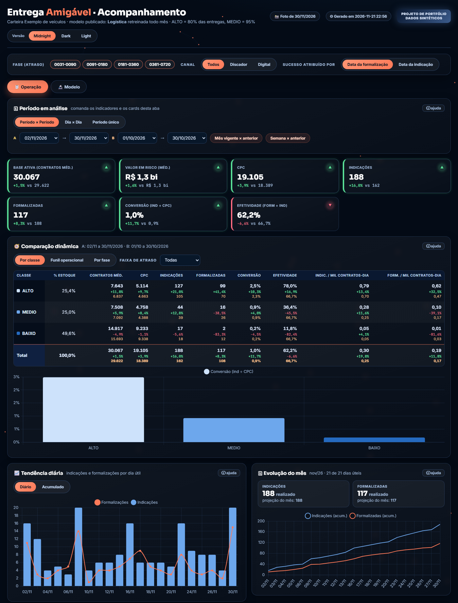
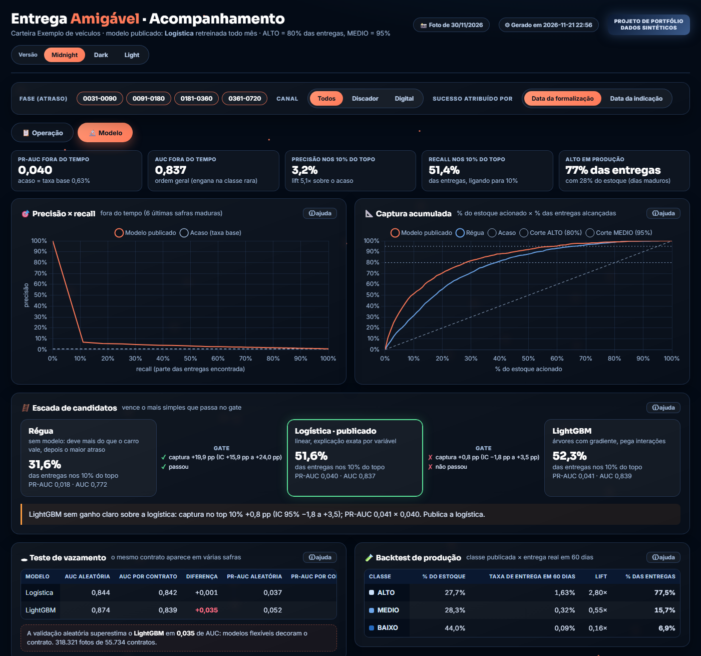
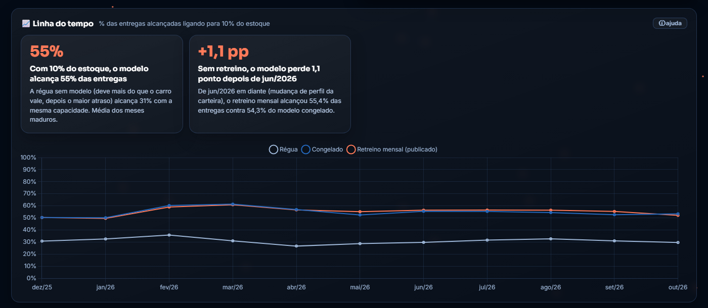
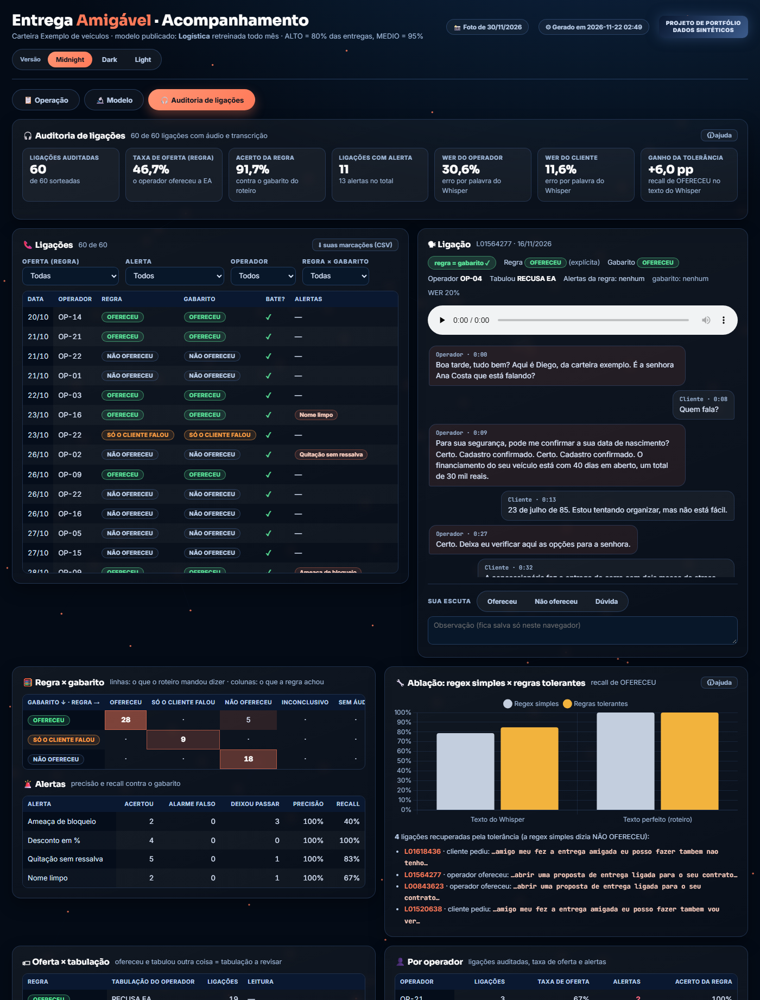

# Entrega Amigável: modelo de classe rara, painel e auditoria de ligações

**Painel ao vivo:** https://alajunior.github.io/entrega-amigavel-cobranca/ · dados 100% sintéticos · projeto de portfólio

No financiamento de veículo em atraso, a **Entrega Amigável (EA)** é quando o cliente devolve o carro de forma voluntária e a dívida é tratada sem busca e apreensão. É bom para os dois lados, e é raro: **menos de 1%** dos contratos em cobrança formaliza uma EA nos 60 dias seguintes. Este projeto mostra o que muda quando a classe positiva é tão rara:

- o modelo diz **quem** a operação deve ligar para ofertar a EA (classes ALTO, MEDIO e BAIXO);
- uma regra explícita diz **se** dá para ofertar agora, e o painel mostra o **porquê** de cada contrato;
- a qualidade é medida pelo que importa nesse caso: **precisão e recall no topo, PR-AUC e captura**. A AUC aparece, mas sozinha engana.

A segunda parte audita as ligações desses clientes. São 60 ligações sintéticas com vozes neurais e linha telefônica simulada, transcritas com faster-whisper. Regras tolerantes a erro de transcrição detectam se o operador ofertou a EA, e o resultado é medido contra o gabarito: **91,7% de acerto**, sem nenhum falso positivo de oferta.



## Como usar (2 minutos)

1. **Aba Operação.** Abre no mês vigente contra o mês anterior.
   - **KPIs:** base ativa, valor em risco, CPC (contato com a pessoa certa), indicações, formalizadas, **conversão** (indicações ÷ CPC) e **efetividade** (formalizadas ÷ indicações).
   - **Filtros globais:** fase de atraso, canal (discador ou digital) e "sucesso atribuído por". Pela data da formalização, a contagem é de caixa. Pela data da indicação, a formalização volta para a coorte da indicação e aparece "em maturação" enquanto a janela não fecha.
2. **Comparação dinâmica.** Três visões: por classe, com recorte por faixa de atraso; funil operacional (Contratos → Trabalhado → Discagem → ALÔ → CPC → Indicação → Formalizada); e por fase.
3. **Fila de ação.** Os contratos ALTO de hoje, cada um com:
   - **APTO:** SIM, A PARTIR DE dd/mm, EM ANDAMENTO, VERIFICAR ou NÃO;
   - o próximo passo;
   - os **2 motivos** que mais empurraram a chance para cima, por exemplo "deve mais do que o carro vale" ou "contato certo recente".
4. **Aba Modelo.** Curva precisão × recall, captura acumulada com os cortes, escada de candidatos com gate, teste de vazamento, backtest de produção, ordenação semanal, cortes por fase com vigência e linha do tempo.
5. **Aba Auditoria de ligações.** As 60 ligações com player e transcrição em balões; o clique num balão leva o áudio ao trecho. Também traz a matriz regra × gabarito, a ablação da tolerância, oferta × tabulação e a visão por operador.

Cada card tem um botão **ⓘ** com o "como ler". Há três temas (Midnight, Dark e Light). O painel funciona no celular.

## O problema e o alvo

- **Foto do dia D:** os contratos ativos em D, com as variáveis calculadas só com o que se sabia **antes** de D. Contato do próprio dia não entra, e acordo só conta como "quebrado" 30 dias depois de feito.
- **Alvo `ea_60d`:** 1 se a primeira formalização de EA cai em **(D, D+60]**. A janela fixa corrige um problema do projeto real, que usava janela aberta e deixava as safras recentes com rótulo cortado.
- **Foto madura:** D + 60 ≤ hoje (30/11/2026). Antes disso o alvo é desconhecido (NaN), nunca zero.
- **Taxa base:** 0,53% nas safras maduras, subindo de 0,47% para 0,73% com a mudança de perfil da carteira em jun/2026.

## A carteira sintética

`dados/gerar_carteira.py` gera 120 mil contratos de financiamento de veículos entre jan/2025 e nov/2026 (seed 42, ~10 s). Isso dá ~29 mil contratos em estoque por dia útil, ~630 CPC, ~6 indicações e ~3,8 formalizações por dia útil. A operação não abre no domingo; o plantão de sábado (~30% de um dia útil) entra na segunda.

- O contrato entra na carteira com 31 dias de atraso. Ele sai por pagamento, busca e apreensão, EA formalizada ou ao passar de 720 dias.
- **Simulação semanal com riscos concorrentes.** O risco latente de EA (não salvo) sobe com:
  - atraso;
  - **dívida ÷ valor atual do carro** (mediana 0,98, p90 1,42);
  - pouco do plano pago e bureau ruim;
  - CPC recente e acordo quebrado.

  Ele também tem interações (por exemplo, deve mais do que o carro vale **e** o carro é velho) e ruído individual.
- A decisão vira **indicação** no primeiro CPC seguinte. A indicação é formalizada (5 a 50 dias depois) ou termina em insucesso com motivo; nesse caso pode haver nova indicação depois.
- **Mudança de regime em 01/06/2026:** entram contratos com bureau pior, o estoque envelhece e o efeito de "dever mais do que o carro vale" fica mais forte.

## Resultados

Os números abaixo saem de `relatorios/` e do painel, gerados com a base completa.

### 1. Escada de candidatos: a logística vence, e o LightGBM não ganha o suficiente para publicar

A pilha fora do tempo (OOT) são as 6 últimas safras maduras: 172 mil fotos e 1.140 entregas (taxa de 0,66%). O treino usa só as safras cujo alvo fechou antes da 1ª safra OOT.

| | PR-AUC | AUC | Precisão no top 10% | Recall no top 10% | Lift |
|---|---|---|---|---|---|
| Régua (dívida ÷ carro, depois maior atraso) | 0,018 | 0,772 | 2,1% | 31% | 3,1× |
| **Logística (publicada)** | **0,055** | **0,845** | **3,7%** | **56%** | **5,6×** |
| LightGBM | 0,058 | 0,845 | 3,7% | 56% | 5,6× |

O **gate** compara cada desafiante com o campeão na captura de entregas nos 10% de maior score. O intervalo de confiança de 95% vem de um bootstrap por **contrato** (1.000 reamostras) e precisa ter limite inferior acima de zero, sem piorar a PR-AUC.

- **Logística contra régua:** **+24,8 pp** (IC +21,0 a +28,6). Passou.
- **LightGBM contra logística:** +0,0 pp (IC −2,5 a +2,8). Não passou, então a logística publica e não há modelo em sombra.

O painel mostraria o duelo publicado × sombra se o LightGBM tivesse passado.



### 2. Teste de vazamento: a validação aleatória mente para o modelo flexível

O mesmo contrato aparece em várias safras. Numa validação cruzada **aleatória**, fotos do mesmo contrato caem no treino e no teste, e o modelo "reconhece" o contrato. A validação **agrupada por contrato** (GroupKFold) mantém todas as fotos de um contrato do mesmo lado.

| Modelo | AUC aleatória | AUC por contrato | Diferença | PR-AUC aleatória | PR-AUC por contrato |
|---|---|---|---|---|---|
| Logística | 0,842 | 0,839 | +0,004 | 0,041 | 0,039 |
| LightGBM | **0,878** | **0,841** | **+0,036** | **0,059** | **0,043** |

Na validação aleatória, o LightGBM parecia bem melhor que a logística. Agrupado por contrato, ele empata. O projeto real fazia a validação cruzada sem agrupar; aqui isso vira um card do painel.

### 3. Cortes por captura, fora da amostra, por fase e com vigência

- **ALTO** = score a partir do qual estão **80%** das entregas; **MEDIO** = 95%. O critério é a captura, não um limiar de 0,5.
- **Os cortes saem de 3 safras que o modelo não viu no treino.** No projeto real, eles saíam das predições do próprio treino, e o ALTO acabava menor do que o previsto.
- **Cada fase tem o próprio corte.** Fase com menos de 30 entregas na calibração usa o global. Na vigência de 02/11/2026, a fase 0031–0090 tinha 28 e usou o corte global.
- **Cada retreino mensal acrescenta uma vigência** (12 no período). Reescorar um dia antigo usa a regra daquele dia.

### 4. Backtest de produção: a classe publicada se comportou

Compara a classe publicada em cada dia útil maduro com a formalização real nos 60 dias seguintes:

| Classe | % do estoque | Taxa de entrega em 60 dias | Lift | % das entregas |
|---|---|---|---|---|
| ALTO | 28,2% | 1,57% | 2,80× | **78,8%** |
| MEDIO | 28,2% | 0,30% | 0,54× | 15,2% |
| BAIXO | 43,6% | 0,08% | 0,14× | 6,0% |

Nas 44 semanas maduras, **nenhuma inversão**: 43 na ordem ALTO > MEDIO > BAIXO e 1 sem entregas suficientes para comparar. O ALTO capturou 78,8% das entregas, perto dos 80% previstos na calibração.

### 5. Linha do tempo para a diretoria



Ligando para **10% do estoque** por dia, o modelo alcança **55%** das entregas, contra **31%** da régua sem modelo (média dos meses maduros). Depois da mudança de perfil de jun/2026, o retreino mensal ganhou **+1,1 pp** do modelo congelado. A logística é estável, e o retreino é barato. Os títulos dessas conclusões são calculados a partir dos números, não escritos à mão.

Como o dado é sintético, a entrega não depende de quem foi acionado. Os simuladores medem a **qualidade da ordem**, não o efeito causal da ligação, e o painel avisa isso.

### 6. Por que o modelo decide e quem formaliza

Na logística, a contribuição de cada variável é exata, sem SHAP: coeficiente × (valor − média do treino), em log-odds. Fora do tempo, as variáveis que mais movem a chance são:

1. **dívida ÷ valor do carro**;
2. fase de cobrança;
3. contato certo em 30 dias;
4. bureau;
5. parte do plano já paga.

Na mediana, quem formaliza deve 1,30× o valor do carro (a base deve 0,98×), pagou 17% do plano (contra 29%), está com 324 dias de atraso (contra 217) e teve contato certo há 18 dias (contra 36).

### 7. Regra APTO_EA: o score diz quem, a regra diz se pode ofertar agora

As regras são aplicadas nesta ordem, olhando só o que se sabia antes do dia:

1. **EM ANDAMENTO:** indicação aberta.
2. **VERIFICAR:** insucesso de EA nos últimos 60 dias.
3. **NÃO:** acordo feito nos últimos 30 dias, ou seja, o cliente está pagando.
4. **A PARTIR DE dd/mm:** ainda não tem 90 dias de atraso.
5. **SIM:** nenhuma das anteriores.

Nos 200 ALTO de hoje: 144 SIM, 32 NÃO e 24 EM ANDAMENTO.

### 8. Travas de produção: melhor não publicar do que publicar errado

`src/producao.py` escora o dia e verifica as travas na ordem abaixo. A primeira que falha encerra a escoragem com o código dela:

| Código | Trava |
|---|---|
| 7 | Dia anterior ao último publicado (nunca regrava o passado). |
| 5 | Modelo em disco diferente do sha256 do manifest, ou manifest ausente. |
| 3 | A foto do estoque não chegou. |
| 4 | Volume abaixo de 85% do último dia publicado. |
| 6 | Participação de ALTO fora de 0,5× a 1,5× do previsto na calibração. |

Se todas passam, o código é **0** e a publicação é atômica: arquivo temporário seguido de `os.replace`. O CSV publicado leva a classe, o APTO e o próximo passo.

## Auditoria de ligações



A pergunta da operação é simples: **o operador ofereceu a Entrega Amigável para o cliente ALTO?** No projeto real, a resposta vinha da gravação: transcrição automática e regras sobre o texto. Aqui o mesmo caminho é refeito com áudio sintético, e com uma vantagem que o real não tem: **gabarito**. Cada ligação nasce de um roteiro que diz exatamente o que foi falado, então dá para medir a regra, e não só acreditar nela.

**Como as 60 ligações foram feitas**

1. **Roteiro com gabarito** (`src/audio/roteiros.py`). Cada ligação parte de um contato real da carteira sintética: discador, contato com a pessoa certa, cliente ALTO naquele dia, últimos 30 dias úteis. O operador e a tabulação são os daquele contato. Uma gramática com seed 42 escreve a conversa: abertura, identidade, dívida, oferta ou não, objeções, fechamento.
   - **Gabarito:** 33 OFERECEU, 9 SÓ O CLIENTE FALOU, 18 NÃO OFERECEU; 15 ligações com alerta de conduta.
   - **Pegadinhas:** "a loja me entregou o carro", "vou te entregar o boleto", oferta só por "devolver o veículo", cliente pedindo a EA sem o operador ofertar, alerta dito pelo cliente. Há também quase-alertas, frases que parecem conduta irregular e não são, para a precisão não ser trivial.
2. **Voz e telefone** (`src/audio/sintetizar.py`). As vozes neurais pt-BR do edge-tts, com velocidade e tom variados, viram 5 personas de cliente e 4 de operador. O operador vai no canal esquerdo e o cliente no direito. Cada canal passa pela linha telefônica: 8 kHz, faixa de 300 a 3.400 Hz, lei µ, ruído e 3% de pacotes perdidos. O canal do operador ainda recebe a conversa das posições vizinhas da central. Saem 60 MP3 de 55 a 97 s, com 16 MB no total.
3. **Transcrição** (`src/audio/transcrever.py`). faster-whisper large-v3-turbo transcreve cada canal separado, com timestamp por palavra. Uma pausa de 1 s abre um balão novo. A limpeza tira o eco do prompt e os loops de repetição. A CPU levou 34 minutos para as 60 ligações.

**O ruído foi calibrado, não chutado.** Com o telefone limpo (SNR de 10 a 25 dB), o Whisper errava só 5,5% das palavras e acertava todas as ofertas, e assim a regra tolerante não teria o que provar. Testei quatro níveis de degradação numa rodada de calibração com 18 das 60 ligações: mesmos roteiros e vozes, outro sorteio de ruído. Com a central nos dois canais, o Whisper inventava falas a partir do fundo. Com a central só no operador, o erro ficou em 31%, como numa ligação real. Mesmo assim ele acertava "entrega amigável" porque o termo estava no prompt. Com um prompt genérico de cobrança, o mesmo que serviria a qualquer carteira, apareceram "entrega ligada" e "entrega migada".

**Resultados contra o gabarito**

| | Resultado |
|---|---|
| Erro por palavra do Whisper (WER) | operador **30,6%** (central ruidosa), cliente **11,6%**; parte é só formatação: o roteiro diz "doze de março" e o Whisper escreve "12 de março" |
| Acerto da regra de oferta | **91,7%** (55 de 60); **88,3%** sem as 2 grafias aprendidas na calibração |
| OFERECEU | 28 de 33 reconhecidas, **nenhum falso positivo** |
| SÓ O CLIENTE FALOU · NÃO OFERECEU | 9 de 9 · 18 de 18 |
| Alertas (todos com precisão de 100%) | desconto em % 4 de 4, quitação sem ressalva 5 de 6, nome limpo 2 de 3, ameaça de bloqueio 2 de 5 |

**Ablação: quanto a tolerância rende.** A regex simples só reconhece "entrega amigável" escrito certo. As regras tolerantes aceitam palavras raras parecidas ("migável", "ligável"), palavras comuns só logo depois de "entrega" ("entrega ligada", sem pegar "uma amiga minha") e uma âncora com até uma letra errada ("entrga").

| | Acerto | Recall de OFERECEU |
|---|---|---|
| Texto perfeito do roteiro: simples = tolerante | 100% | 100% |
| Texto do Whisper, regex simples | 85,0% | 78,8% |
| Texto do Whisper, regras tolerantes | **91,7%** | **84,8%** |

A tolerância recuperou **4 ligações**: duas "entrega ligada" na fala do operador e duas "entrega amigada" do cliente. Ela não criou nenhum falso positivo. Com o texto perfeito as duas empatam, então a distância é o custo da transcrição, e não da regra.

**Onde a regra errou, e por que eu não corrigi.** Em 2 ofertas a frase sumiu da transcrição: com a central ao fundo, o Whisper simplesmente não a escreveu. Em 1, virou "entrega migarro". Em outras 2, "amigável" virou **"viável"**, uma palavra real. Nos alertas, "penhorar" virou "melhorar" duas vezes. Colocar "entrega viável" no mapa agora subiria o acerto, mas esse erro foi visto no conjunto de teste. Ajustar a regra a ele seria medir com a régua que acabou de ser cortada sob medida. No ciclo real, a grafia entra no mapa e a próxima rodada de ligações mede de novo. As duas grafias que entraram ("migada", "amigada") vieram da rodada de calibração. Só que essa rodada usou os mesmos roteiros e as mesmas vozes, com outro ruído, então ela não é independente do teste. As duas respondem por 2 das 4 ligações recuperadas. Sem elas, o acerto cai para **88,3%**, e o recall de OFERECEU não muda, porque esses dois ganhos são do lado do cliente. Os dois números ficam aqui de propósito.

**O que a operação leva daqui**

- **Oferta × tabulação:** em 5 ligações a regra ouviu a oferta e o operador tabulou outra coisa (acordo, renegociação, sem desfecho): é tabulação a revisar. No sentido inverso, 5 ligações tabuladas como RECUSA EA não têm oferta reconhecível no texto, e é exatamente aí que vale a escuta humana.
- **Por operador:** taxa de oferta e alertas por operador. Com 60 ligações, isso serve para escolher quem escutar, não para punir ninguém.
- **No painel:** a lista é filtrável por oferta, alerta, operador e acerto. Ao abrir uma ligação, o player toca o áudio e a transcrição aparece em balões. Clicar num balão leva o áudio ao trecho, as palavras que dispararam a regra ficam destacadas e um selo mostra a regra contra o gabarito. A marcação humana (Ofereceu / Não / Dúvida, mais observação) fica no navegador e sai em CSV.

A regra é reaplicada sobre o texto salvo a cada build, sem retranscrever, como no projeto real. A CI testa a lógica com textos de exemplo e nunca instala edge-tts nem faster-whisper. Nenhum áudio ou texto real foi usado.

## Como rodar

```bash
pip install -r requirements.txt
python dados/gerar_carteira.py      # carteira sintética de 120 mil contratos (~10 s)
python -m src.treinar               # escada com gate, teste de vazamento e importância em relatorios/ (~1 min)
python -m src.montar_painel         # escoragem diária em 3 modos, agregados e docs/index.html (~3 min; cache em dados/escoragem/)
python -m pytest                    # 147 testes
```

**Áudio (opcional, local; a CI não roda).** Roteiros, MP3 e transcrições já estão versionados, e o build só reaplica as regras sobre o texto salvo. Para refazer tudo do zero:

```bash
pip install -r requirements-audio.txt   # edge-tts, faster-whisper, PyAV
python -m src.audio.roteiros            # dados/ligacoes/roteiros.json (roteiro + gabarito)
python -m src.audio.sintetizar          # docs/audio/*.mp3 e dados/ligacoes/tempos.json (rede só aqui; --proxy se precisar)
python -m src.audio.transcrever         # dados/ligacoes/transcricoes.jsonl (~35 s por ligação na CPU; retoma de onde parou)
```

Para ver o painel, sirva a pasta `docs/` (por exemplo `python -m http.server --directory docs`). A cada push na `main`, a CI gera uma base pequena, roda o treino e os testes, e publica `docs/` no GitHub Pages.

## Estrutura

```
dados/gerar_carteira.py      gerador sintético (financiamento de veículos, funil de EA, mudança de regime)
src/config.py                datas, janela do alvo, fases, faixas de atraso, classes
src/base_analitica.py        foto as-of do dia D e alvo de 60 dias sem futuro
src/modelos.py               régua, logística e LightGBM no mesmo Pipeline
src/metricas.py              PR-AUC, precisão e recall no topo, lift
src/candidatos.py            escada com gate e IC bootstrap por contrato
src/validacao.py             teste de vazamento: aleatório × GroupKFold por contrato
src/cortes.py                cortes ALTO/MEDIO por captura, por fase, com vigência
src/escoragem.py             modelo vigente (retreino mensal), congelado e sombra
src/sinal.py                 contribuição exata da logística e motivos direcionais
src/apto.py                  regra APTO_EA e próximo passo
src/producao.py              escoragem diária com travas e publicação atômica
src/qualidade.py             backtest de produção, ordenação semanal, estabilidade
src/linha_tempo.py           régua × congelado × retreino, conclusões calculadas
src/treinar.py               orquestra a escada, o vazamento e a importância
src/montar_painel.py         monta o payload (atribuição as-of) e grava o HTML
src/painel.html              o painel (HTML, CSS e JS puro; Chart.js; fundo em canvas)
src/audio/roteiros.py        seleção das ligações na carteira e roteiros com gabarito
src/audio/regras.py          regras de oferta e de alerta tolerantes a erro de transcrição
src/audio/sintetizar.py      vozes neurais, central, telefone e MP3 estéreo
src/audio/transcrever.py     Whisper por canal, turnos por pausa, limpeza, WER, checkpoint
src/audio/medir.py           regra × gabarito: confusão, alertas, ablação, tabulação, operador
dados/ligacoes/              roteiros.json, tempos.json, transcricoes.jsonl
docs/                        o painel publicado, os 60 MP3 (docs/audio/) e as imagens deste README
relatorios/                  escada.json, vazamento.json, importancia.csv
tests/                       147 testes: futuro, alvo, gate, cortes, vigência, travas, APTO, as-of, payload, regras, pegadinhas, telefone, turnos, WER, medição, guarda de publicação
```
